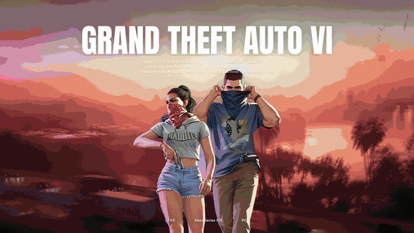

<div align="center">

# GTA VI — Fan Site

**A scroll-driven, cinematic landing page built as a motion and front-end study.**

[Live demo](https://tanoliusama249-star.github.io/gta6-fan-site/) · [Report a bug](https://github.com/tanoliusama249-star/gta6-fan-site/issues)



</div>

---

## About

A single-page fan site recreating the feel of a modern game launch page: a self-assembling collage hero, a giant sliding headline, a full-screen trailer with a custom cursor, slanted story cards, a horizontal character carousel, film strips, a map that turns into a product card, and a full-screen "Ride or Die" finale.

Everything is hand-written HTML, CSS and JavaScript — no framework, no build step.

## Highlights

| Section | What happens |
| --- | --- |
| **Hero** | Eight image tiles fly in from scattered positions and lock into a collage around the logo |
| **"We waited 12 years"** | Giant tilted headline scrubs sideways; a *Watch trailer* disc follows the cursor |
| **Trailer** | Full-screen video, ring cursor toggles **Pause / Play**, letter-by-letter credit with chromatic glow |
| **New Story** | Two slanted cards tilt into place, then their white frames draw on |
| **Meet the locals** | Vertical scroll drives a pinned horizontal character carousel with parallax images and a progress bar |
| **Gameplay** | Two film strips drift in opposite directions on scroll |
| **Coming Soon** | A 3D-tilted map card lands, then morphs into the product card |
| **Ride or Die** | The words split apart, side cards fly off, and the centre artwork grows to full screen |

Also: smooth scrolling, auto-hiding nav, mobile menu, `prefers-reduced-motion` support.

## Built with


## Run locally

```bash
git clone https://github.com/tanoliusama249-star/gta6-fan-site.git
cd gta6-fan-site
npx serve .        # or: python -m http.server
```

Then open the local URL it prints. (Opening `index.html` directly works too.)

## Project structure

```
├── index.html        markup for all sections
├── css/style.css     layout, typography, responsive rules
├── js/main.js        all motion: GSAP timelines, ScrollTrigger, cursor
├── assets/           images, cut-outs and the trailer video
├── fonts/            Anton + Inter (self-hosted)
└── vendor/           GSAP, ScrollTrigger, Lenis
```

## Disclaimer

Unofficial fan project made for learning. Not affiliated with, endorsed by, or connected to Rockstar Games or Take-Two Interactive. *Grand Theft Auto* and all related artwork are the property of their respective owners. The MIT license covers the code only, not the game artwork.

---

<div align="center">Designed &amp; built by <a href="https://github.com/tanoliusama249-star">Usama</a></div>
